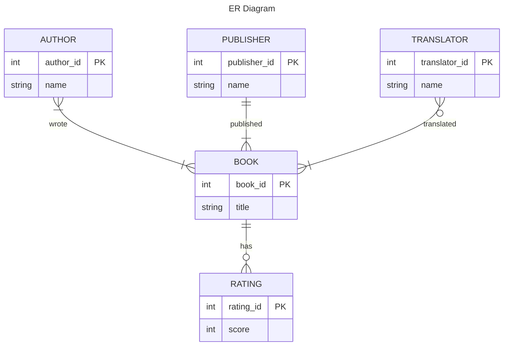

# CS50 SQL - Lecture 1 - Relating

TABLE OF CONTENTS

- 00:00:00 - Introduction
- 00:00:17 - Relating
- 00:08:23 - Entity Relationship Diagrams
- 00:13:35 - Keys
- 00:26:35 - Subqueries
- 00:55:47 - Joins
- 01:16:59 - Sets
- 01:30:29 - Groups

## Comands

- .tables

---

## Entity Relationship Diagrams

- We just described one-to-one, one-to-many and many-to-many relationships between tables in a database. It is possible to visualize such relationships using an entity relationship (ER) diagram.

## Crow's Foot Notation

──────────○  Zero  
──────────|  One  
──────────<  Many  

---

Notação de cardinalidade (Crow's Foot)
| Símbolo | Significado |
|:---:|---|
| ○ | Zero |
| \| | Um |
| ⟨ | Muitos |

---

### Mermaid Structure for Crow's Foot Notation

| Símbolo | Significado |
|---|---|
| \|\| | Exatamente um |
| o\| | Zero ou um |
| o{ | Zero ou muitos |
| }\| | Um ou muitos |
| }o | Zero ou muitos |

---

Combinações utilizadas em diagramas ER:

| Símbolo | Significado |
|:---:|---|
| ○\| | Zero ou um (0..1) |
| \|\| | Exatamente um (1..1) |
| ○< | Zero ou muitos (0..N) |
| \|< | Um ou muitos (1..N) |

---

## Keys

- Keys also help relate tables in SQL.
- A foreign key is a primary key taken from a different table. By referencing the primary key of a different table, it helps relate the tables by forming a link between them.

## Subqueries

A subquery is a query inside another query. These are also called nested queries.

